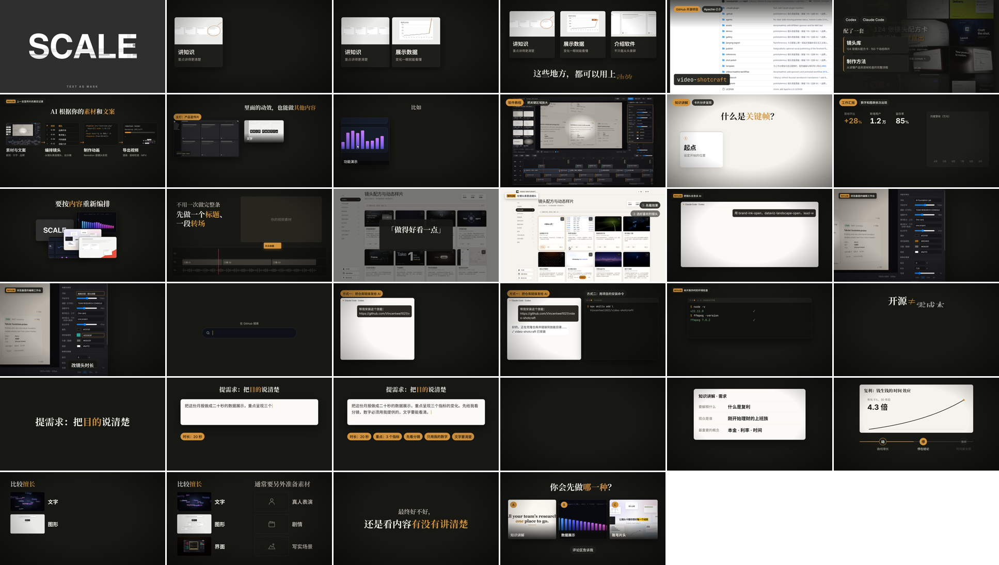
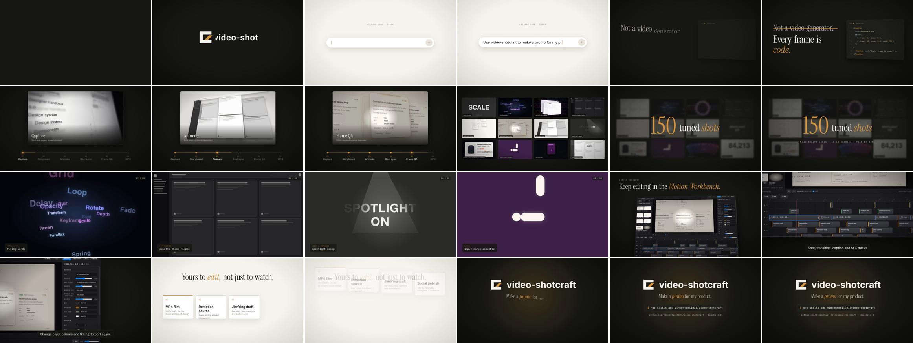

# video-shotcraft videos

Two films about [video-shotcraft](https://github.com/Vincentwei1021/video-shotcraft), the open-source
Claude Code / Codex skill that turns your material into motion-designed videos with Remotion.

## 1. 口播配套视频 · Narration explainer (2:50, Chinese)

Picture track for the Chinese narration script
[video-shotcraft 视频口播脚本](https://github.com/vcproo/video-text/blob/main/video-shotcraft_%E5%8F%A3%E6%92%AD%E8%84%9A%E6%9C%AC.md).
Per the script, it has no voiceover and no subtitles: on-screen text is short Chinese keyword cards timed to each line,
so the narration can be recorded over it.

- **▶ [video-shotcraft-explainer.mp4](video-shotcraft-explainer.mp4)** · sound effects + a low music bed, ready to narrate over
- **▶ [video-shotcraft-explainer-no-music.mp4](video-shotcraft-explainer-no-music.mp4)** · sound effects only, for your own music

1920×1080 · 30 fps · H.264 + AAC

It explains how to use the project, shows results, and shows the real production process along the way:

| Time | Narration | Picture |
|---|---|---|
| 0:00 | 能不能让 AI 做出专业感 | Fast cuts from the shot library → the question |
| 0:04 | 讲知识 / 展示数据 / 介绍软件 | Three scenario cards → "都可以用上动效" |
| 0:17 | 开源项目 video-shotcraft | GitHub repo → shot library + method → **process**: material → storyboard → code → render |
| 0:31 | 主打宣传片，也能做其他内容 | The intro film below → text / cards / charts / UI → demos, data, intros |
| 0:44 | 教程放大、知识分步、汇报依次出现 | Three demos built for this video |
| 0:58 | 不必一次做完整条 | Shots re-arranged → a title and a transition dropped into an edit timeline |
| 1:09 | 先看效果、选镜头、告诉 AI | **Process**: the live gallery (select 3 → copy) → shot names sent to the AI → storyboard |
| 1:23 | 编辑工作台继续改 | **Process**: Motion Workbench edits to text, colour and duration |
| 1:35 | 怎么安装 | GitHub search → send the link to the AI, or `npx skills add` |
| 1:48 | 环境与成本 | **Process**: this project's real environment check → "开源 ≠ 零成本" |
| 1:59 | 提需求要说清目的 | The monthly-report brief typed out → storyboard first → result |
| 2:15 | 知识讲解怎么交代 | Brief form → move / hold / stress in a compound-interest demo |
| 2:29 | 擅长与局限 | Text, graphics, UI vs. live action, story, realistic scenes |
| 2:41 | 你会选哪种 | A/B/C question → sign-off |

## 2. Intro film (0:49, English)

**▶ [video-shotcraft-intro.mp4](video-shotcraft-intro.mp4)** · 1920×1080 · 30 fps · H.264 + AAC

1. Logo build: "Cinematic product films, shot by your agent."
2. The prompt: "Use video-shotcraft to make a promo for my product."
3. "Not a video generator. Every frame is code."
4. The pipeline: capture → storyboard → animate → beat sync → frame QA → MP4
5. A wall of shots resolving into "150 tuned shots"
6. An eight-shot montage from the shot library
7. The Motion Workbench editor
8. Outputs: MP4, Remotion source, JianYing draft, social publishing
9. Outro with the install command

Every cut lands on the beat of a 122 BPM track.

## Credits and licenses

- video-shotcraft by Vincent Wei, Apache-2.0. Logo, Workbench screenshots and shot clips come from the repository
  and its gallery release. Gallery and GitHub pages were captured live.
- Demo content in the explainer (tutorial zoom, keyframe cards, quarterly report, monthly report, compound-interest
  curve) was built for these videos; the numbers are sample data.
- Music: "Tonight" by Michael Ramir C. (explainer) and "House Vibez" by Lily J (intro), Mixkit Stock Music Free License.
- Sound effects: Mixkit (Mixkit Sound Effects Free License).
- Fonts: Noto Serif SC, Noto Sans SC, Instrument Serif, Inter, JetBrains Mono (SIL Open Font License).
- Rendered with [Remotion](https://www.remotion.dev/).

These are fan-made videos, not official video-shotcraft releases.
